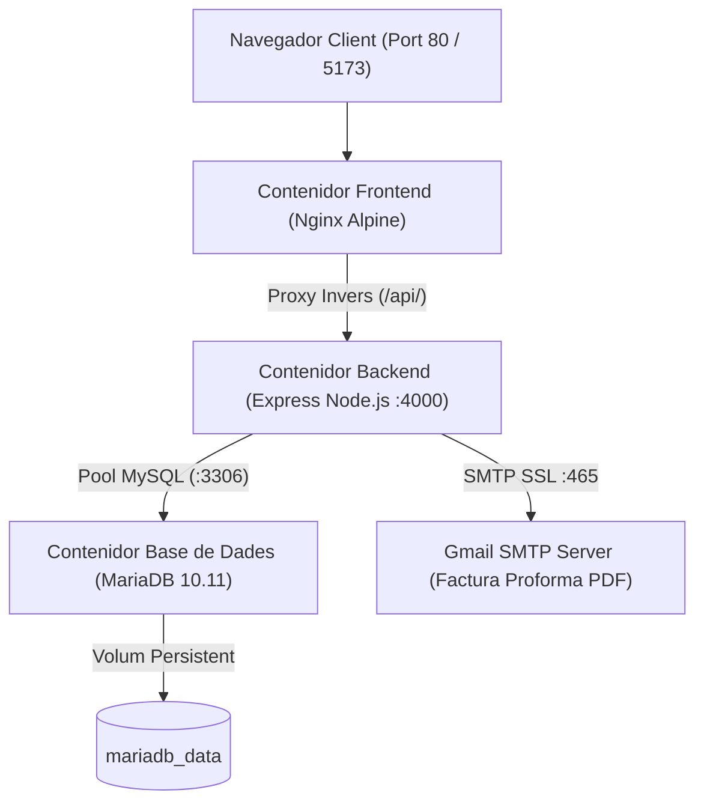

# GUIA DE DESPLEGAMENT EN CONTENIDORS DOCKER · KERNELCORE
## Projecte de Síntesi CFGM SMX (2026/27) · DFactory Barcelona
## Hans Lao Moncusí & Joel Pérez Armenteros

Aquest document descriu l'arquitectura de contenidorització de **KernelCore**, dissenyada per a desplegar la solució completa (Base de Dades SQL, API REST Backend i Frontend Web Nginx) en qualsevol entorn de producció amb una sola comanda.

---

### 1. Arquitectura de Serveis en Contenidors

El projecte s'estructura en **3 microserveis aïllats** comunicats mitjançant una xarxa interna de tipus *bridge* (`kernelcore-network`):



1. **`kernelcore-mariadb` (MariaDB 10.11)**:
   - S'inicialitza automàticament executant l'esquema SQL complet `database/kernelcore_db.sql`.
   - Persistència garantida mitjançant el volum Docker `mariadb_data`.
   - Inclou verificació d'estat de salut (*healthcheck*) per assegurar que està llesta abans d'iniciar l'API.

2. **`kernelcore-backend` (Node.js 22 Express)**:
   - Serveix l'API REST al port 4000.
   - Generació de Factures Proforma en PDF binari en memòria (`pdfkit`).
   - Enviament de correus amb fitxers adjunts mitjançant protocol SMTP (`nodemailer`).
   - Connectat a la base de dades mitjançant el nom d'amfitrió intern `mariadb`.

3. **`kernelcore-frontend` (React 19 + Vite + Nginx Alpine)**:
   - Compilació *multi-stage* ultra-lleugera (només ocupa uns pocs megabytes).
   - Servidor Nginx que actua de servidor web estàtic i de **proxy invers** per a redirigir automàticament les crides `/api/` cap al backend sense problemes de CORS.
   - Accessible tant pel port web estàndard **80** com pel port **5173**.

---

### 2. Com arrencar el projecte amb Docker

#### Pas 1: Instal·lar Docker Desktop (si encara no el teniu)
Si esteu a Windows:
1. Descarregueu i instal·leu **Docker Desktop for Windows** des del web oficial: [https://www.docker.com/products/docker-desktop/](https://www.docker.com/products/docker-desktop/).
2. Assegureu-vos que teniu activat **WSL 2** (Windows Subsystem for Linux).
3. Obriu Docker Desktop fins que la icona de la balena estigui en verd (*Engine running*).

#### Pas 2: Aixecar tots els serveis amb una sola comanda
Obriu un terminal (PowerShell o CMD) a la carpeta del projecte i executeu:

```powershell
docker compose up -d --build
```

Aquest procés farà automàticament:
1. Descarregarà la imatge de MariaDB 10.11.
2. Construirà la imatge del backend i instal·larà les dependències.
3. Compilarà el frontend en React i crearà la imatge de Nginx.
4. Carregarà l'esquema i les 100 referències de la base de dades.
5. Connectarà els 3 contenidors a la xarxa virtual.

#### Pas 3: Comprovar que els contenidors estan funcionant
```powershell
docker compose ps
```

Veureu els 3 contenidors amb estat `Up` (healthy).

#### Pas 4: Accedir a l'aplicació
- **Web Pública i Panell Dashboard**: [http://localhost](http://localhost) o [http://localhost:5173](http://localhost:5173)
- **API Backend**: [http://localhost:4000/api/health](http://localhost:4000/api/health)
- **Base de Dades MariaDB**: Port `3306` (usuari `root`, contrasenya `kernelcore_root_secure`)

---

### 3. Comandes útils de gestió

- **Veure els registres (logs) en temps real**:
  ```powershell
  docker compose logs -f
  ```
- **Veure els logs d'un servei en concret (per exemple el backend)**:
  ```powershell
  docker compose logs -f backend
  ```
- **Aturar els serveis sense esborrar les dades de la base de dades**:
  ```powershell
  docker compose down
  ```
- **Aturar i reiniciar de zero (esborrant volums si es vol regenerar la BBDD)**:
  ```powershell
  docker compose down -v
  docker compose up -d --build
  ```

---

### 4. Per què és un punt clau per a la defensa del CFGM SMX?

1. **Compliment dels estàndards de la indústria (DevOps / SysAdmin)**:
   - Permet demostrar davant el tribunal que no només sabeu programar o muntar cables, sinó que sabeu empaquetar i desplegar serveis en arquitectura de microserveis moderna.
2. **Independència del sistema operatiu**:
   - Funciona exactament igual a Windows, a Linux (Ubuntu Server a un servidor de DFactory) o a macOS, sense instal·lar XAMPP manualment ni dependre de versions locals de Node.
3. **Aïllament i Seguretat**:
   - Si la base de dades cau o es reinicia, no afecta l'amfitrió.
   - Nginx protegeix el backend i la base de dades no està exposada directament a internet.
