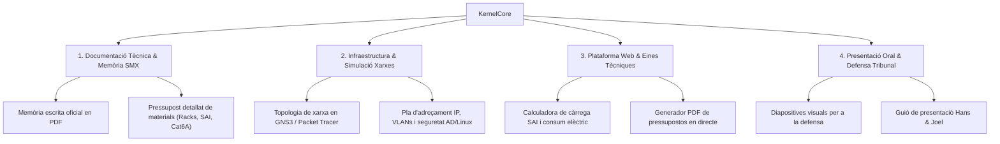

# Pla de Treball Executiu — KernelCore (Mòdul de Síntesi SMX)

**Empresa:** KernelCore  
**Seu Oficial:** DFactory Barcelona, Carrer 27 del BZ, 10-16 (Zona Franca), 08040 Barcelona  
**Equip Directiu & Tècnic:** Hans Lao Moncusi & Joel Pérez Armenteros  
**Cicle Formatiu:** Sistemes Microinformàtics i Xarxes (SMX) — Curs 2026/27  

---

## 1. Estat Actual & Assoliments Clau
- [x] **Rebranding Complet:** Canvi de nom de KryptonCore a **KernelCore** (elimina connotacions de crypto; enfocat a sistemes i xarxes pures).
- [x] **Identitat Visual HQ:** Logotip hexagonal en alta resolució (`logo.png`) i fotografies professionals dels socis (`Hans.svg` i `Joel.svg`) amb proporció simètrica d'alta qualitat.
- [x] **Seu Única Oficial:** Establerta a **DFactory Barcelona (Zona Franca)** a tot el web (Contacte, Hero, Footer i Avís Legal).
- [x] **Física i Animacions Contínues:** Integrat **Anime.js v4** i motor harmònic `requestAnimationFrame` a 60 FPS constants sense salts de fotogrames.
- [x] **Experiència d'Usuari Adaptativa (Serveis):**
  - **Ordinador:** Canvi instantani de fitxa amb sobrevol de ratolí (`onMouseEnter`).
  - **Mòbil:** Desplegament progressiu automàtic dels acordions per scroll (`IntersectionObserver`).
- [x] **Suite Legal i Compliment Normatiu:**
  - Avís Legal (Art. 10 LSSI-CE 34/2002).
  - Política de Privacitat (RGPD 2016/679 & LOPD-GDD 3/2018).
  - Política de Cookies granular amb selector de consentiment tècnic/analític.
  - Termes i Condicions de Serveis i Garantia de Desistiment de 14 dies (TRLGDCU).
  - Bàner d'alta visibilitat de Transparència Ètica (Directiva Europea 2019/2161/UE Llei Òmnibus contra ressenyes falses).
  - Formulari de contacte i pressupost amb caixes de consentiment desacoblades del text.

---

## 2. Àrees de Treball Pendents & Objectius

---

## 3. Delegació mitjançant Subagents Especialitzats

Per agilitzar la feina i avançar en paral·lel sense perdre rigor tècnic, establim l'equip d'agents de suport:

### Subagent 1: **Enginyer de Xarxes & Maquinari (Suport Joel)**
- **Àmbit:** Cablejat Cat6A, armaris Rack 19", dimensionament de potència SAI (W/VA), càlcul d'autonomia (+20%) i disseny de VLANs.
- **Tasques immediates:**
  - Elaborar el llistat complet de materials de xarxa amb referències reals de fabricants (Schneider/APC, Cisco, Ubiquiti, Legrand).
  - Redactar l'especificació tècnica de certificació de rosetes RJ45 sota estàndard TIA/EIA 568.2-D.

### Subagent 2: **Administrador de Sistemes & Seguretat (Suport Hans)**
- **Àmbit:** Windows Server 2025, Active Directory DS, Linux Enterprise (Debian/Ubuntu), Proxmox VE i còpies de seguretat GFS 3-2-1.
- **Tasques immediates:**
  - Redacció de la política de còpies de seguretat contra ransomware (estratègia 3-2-1 amb NAS local + Cloud xifrat).
  - Estructuració de les Polítiques de Grup (GPO) per a equips i usuaris de l'empresa tipus.

### Subagent 3: **Arquitecte Web & Interactivitat**
- **Àmbit:** Frontend React + Tailwind, càlculs en temps real i descàrrega de documents.
- **Tasques immediates:**
  - Afegir una mini-calculadora interactiva a la web per estimar l'autonomia del SAI segons el consum dels equips.
  - Implementar la descàrrega directa del resum del pressupost personalitzat en PDF per als clients.

### Subagent 4: **Preparador de Memòria & Tribunal**
- **Àmbit:** Estructura acadèmica del Projecte de Síntesi SMX, format APA/IEEE i preparació de preguntes difícils del tribunal.
- **Tasques immediates:**
  - Índex general de la Memòria del Projecte.
  - Diapositives clau amb justificació de la seu a **DFactory Barcelona** i del model de negoci.

---

## 4. Cronograma de Treball Immediat

| Fase | Objectiu Principal | Responsable / Agent |
| :--- | :--- | :--- |
| **Setmana 1** | Tancament de simulacions tècniques (GNS3) i llista de materials | Subagent Xarxes + Joel |
| **Setmana 2** | Redacció de sistemes (AD, Linux, Proxmox, Backups 3-2-1) | Subagent Sistemes + Hans |
| **Setmana 3** | Eines interactives a la web (Calculadora SAI + Exportació PDF) | Subagent Web |
| **Setmana 4** | Memòria escrita final i assaig de la defensa oral | Subagent Memòria + Hans & Joel |
