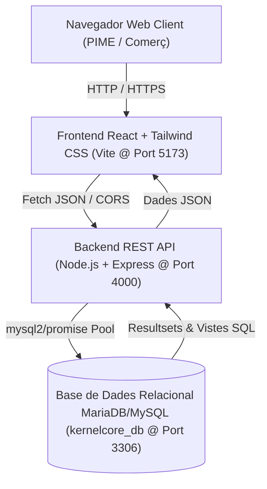
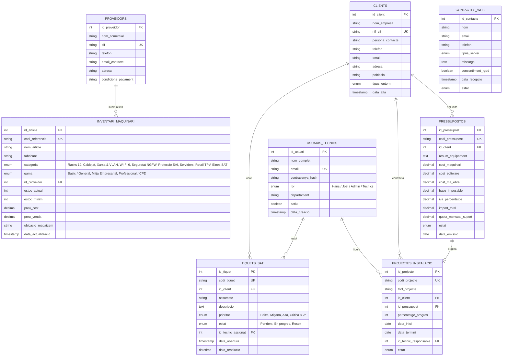

# Document d'Arquitectura Backend & Model de Base de Dades — KernelCore

**Cicle Formatiu:** CFGM Sistemes Microinformàtics i Xarxes (SMX) — Mòdul de Síntesi (M1713)  
**Entorn Operatiu:** DFactory Barcelona, Carrer 27 del BZ, 10-16 (Zona Franca), 08040 Barcelona  
**Responsables Tècnics:** Hans Lao Moncusi & Joel Pérez Armenteros  

---

## 1. Arquitectura del Sistema (Fullstack N-Capes)

---

## 2. Diagrama Entitat-Relació (Model E/R)

---

## 3. Endpoints de l'API REST (`http://localhost:4000`)

| Mètode | Endpoint | Funció | Descripció |
| :--- | :--- | :--- | :--- |
| **GET** | `/` | Portal Gateway | Retorna la interfície d'estat del servidor o el manifest JSON de rutes actives. |
| **GET** | `/database/kernelcore_db.sql` | Descàrrega SQL | Descarrega directament l'esquema relacional complet `kernelcore_db.sql` (100 SKUs). |
| **GET** | `/api/health` | Diagnòstic | Retorna l'estat del servidor, temps de funcionament i mode de connexió SQL / Memòria SMX. |
| **POST** | `/api/auth/login` | Autenticació | Valida credencials d'accés al panell tècnic contra `usuaris_tecnics` (SHA-256) o `liveStore`. |
| **GET** | `/api/contacte` | Llistat Contactes | Retorna les consultories rebudes des del formulari de contacte web (`contactes_web`). |
| **POST** | `/api/contacte` | Formulari Contacte | Registra una nova consulta web amb consentiment RGPD a `contactes_web` i `liveStore.contacts`. |
| **GET** | `/api/clients` | Llistat Clients | Consulta els clients corporatius registrats a MariaDB (`clients`) o a `liveStore.clients`. |
| **POST** | `/api/clients` | Nou Client | Dona d'alta un nou client corporatiu a la taula `clients` de MariaDB i a `liveStore.clients`. |
| **DELETE** | `/api/clients/:id` | Baixa Client | Elimina un client de `liveStore.clients` i de la taula `clients` de MariaDB. |
| **GET** | `/api/proveidors` | Llistat Proveïdors | Retorna els proveïdors majoristes oficials de `proveidors` enriquits amb les marques homologades. |
| **POST** | `/api/proveidors` | Nou Proveïdor | Registra un nou proveïdor majorista a la taula `proveidors` de MariaDB i a `liveStore.suppliers`. |
| **GET** | `/api/sollicituds` | Llistat Leads | Retorna les sol·licituds de pressupost i consultoria empresarial en curs. |
| **POST** | `/api/sollicituds` | Nova Sol·licitud | Registra una nova sol·licitud d'auditoria o desplegament d'infraestructura. |
| **PATCH** | `/api/sollicituds/:id/status` | Estat Lead | Actualitza l'estat operatiu d'una sol·licitud de client. |
| **GET** | `/api/pressupostos` | Llistat Quotes | Retorna els pressupostos amb el detall econòmic (Total + Manteniment mensual). |
| **POST** | `/api/pressupostos` | Nou Pressupost | Registra una proposta comercial des del pressupostador interactiu. |
| **PATCH** | `/api/pressupostos/:id/status` | Estat Pressupost | Commuta l'estat d'un pressupost (`Pendent de signatura` / `Aprovat` / `En curs`). |
| **GET** | `/api/projectes` | Desplegaments | Retorna els projectes d'enginyeria en curs, responsable tècnic i fites d'execució. |
| **POST** | `/api/projectes` | Nou Projecte | Crea un nou projecte d'enginyeria a `liveStore.projects` i a `projectes_instalacio` de MariaDB. |
| **POST** | `/api/projectes/:id/tasks` | Nova Fita Projecte | Afegeix una nova tasca tècnica al projecte `:id` i recalcula el percentatge de progrés. |
| **PATCH** | `/api/projectes/:id/tasks/:taskIndex/toggle` | Fites Projecte | Marca o desmarca una tasca tècnica i recalcula el percentatge de progrés. |
| **GET** | `/api/inventari` | Estoc 100 SKUs | Retorna el catàleg complet de 100 referències de maquinari per categoria i gama. |
| **PATCH** | `/api/inventari/:id/stock` | Ajust d'Estoc | Incrementa o redueix l'estoc d'una referència al magatzem de DFactory Barcelona. |
| **POST** | `/api/inventari/inversio-capital` | Injecció Capital | Executa plans d'aprovisionament massiu d'estoc per gama (`basic_general`, `mid_networking`, `enterprise_servers`, `megapack_multibrand`). |
| **GET** | `/api/tiquets` | Helpdesk SAT | Retorna els tiquets d'incidències i manteniment SLA amb el tècnic assignat. |
| **PATCH** | `/api/tiquets/:id/resolve` | Resolució SAT | Marca un tiquet d'incidència com a `Resolt`. |
| **GET** | `/api/telemetria` | Monitoratge | Retorna mètriques en temps real (CPU, RAM, disc, latència ping i serveis) dels nodes crítics. |
| **POST** | `/api/diagnostics/ping` | Diagnòstic Xarxa | Executa una prova de latència ICMP simulada contra un host o passarel·la de DFactory. |
| **GET** | `/api/audit` | Estat Auditoria | Retorna l'última auditoria automàtica del sistema i l'historial (`liveStore.auditLogs`). |
| **POST** | `/api/audit/run` | Execució Auditoria | Dispara una auditoria de seguretat, inventari, telemetria i RBAC sota demanda en temps real. |
| **POST** | `/api/generate/request` | Simulador Lead | Genera una nova sol·licitud empresarial realista en temps real. |
| **POST** | `/api/generate/ticket` | Simulador SAT | Genera un nou tiquet tècnic SAT automàtic en temps real. |
| **POST** | `/api/generate/reset` | Reinici Dades | Restaura totes les col·leccions de `liveStore` a l'estat inicial de referència. |

---

## 4. Seguretat i Bones Pràctiques per a la Memòria SMX

1. **Injecció SQL previnguda:** Ús exclusiu de consultes preparades amb marcadors de posició (`?`) mitjançant `mysql2/promise`.
2. **Xifratge de claus:** Contrasenyes emmagatzemades amb hash `SHA2(contrasenya, 256)`.
3. **CORS controlat:** Protecció contra peticions d'orígens no autoritzats restringit a `http://localhost:5173`.
4. **Resiliència (High Availability):** Si el servei de MariaDB està aturat o en manteniment, el backend activa automàticament el mode de seguretat Fallback/Mock per no deixar la web fora de servei.
5. **Auditoria Automàtica Programada:** Un procés cron intern (`setInterval` cada 60 segons) verifica l'estat de MariaDB, la integritat dels 100 SKUs d'inventari, els 4 nodes de telemetria crítica, els 3 comptes RBAC i els projectes/tiquets SAT actius.
